# Task 1: Multi-Container Pods (Init Container & Sidecar)

An Nginx "Hello" page running on a **3-node Minikube cluster** (1 control-plane + 2 workers, **Calico** CNI). The page shows the current timestamp, and a sidecar refreshes it every 5 seconds:

```text
hello in MLOPS MENA COMMUNITY : 2026-11-04 11:15:05
```

Each Pod has three containers, uses **no volumes**, and relies on `shareProcessNamespace: true` so the containers can see each other.

---

## 📁 Files

| File | Purpose |
|---|---|
| `namespace.yaml` | The `webapp` namespace |
| `deployment.yaml` | The working Deployment `web-deployment` (3 replicas, init container + nginx + sidecar) |
| `deployment-broken.yaml` | Same Deployment, but `init-done` exits with code `1` on purpose |
| `service.yaml` | Optional NodePort Service `web-service` that exposes the Pods on port 80 |
| `screenshots/` | Evidence for every step below |

| Resource | Name |
|---|---|
| Namespace | `webapp` |
| Deployment / Pod label | `web-deployment` / `app: web` |
| Containers | `init-done`, `nginx`, `time-updater` |
| Images | `busybox:1.36` (init + sidecar), `nginx:1.27` |

---

## 📦 Pod Architecture

| Container | Type | What it does |
|---|---|---|
| `init-done` | Init container (`busybox:1.36`) | Prints `done` and exits `0`. The other containers start only after it succeeds. |
| `nginx` | Main container (`nginx:1.27`) | Writes the first `index.html` with the current time, then serves it on port `80` |
| `time-updater` | Sidecar (`busybox:1.36`) | Every 5 seconds, finds the nginx master PID and rewrites the page through `/proc/<pid>/root/usr/share/nginx/html/index.html` |

### How the sidecar edits nginx's file without a volume

1. `shareProcessNamespace: true` puts all containers in the Pod in **one process namespace**, so `time-updater` can see the nginx process.
2. `pgrep -o nginx` gets the PID of the oldest nginx process (the master).
3. `/proc/<pid>/root` points to **that process's root filesystem**. Writing to `/proc/<pid>/root/usr/share/nginx/html/index.html` changes the file nginx is serving.
4. The `SYS_PTRACE` capability lets the sidecar access another container's `/proc/<pid>/root`.

### Zero-downtime settings (extra)

```yaml
strategy:
  type: RollingUpdate
  rollingUpdate:
    maxSurge: 1        # create at most 1 extra Pod during an update
    maxUnavailable: 0  # never remove an old Pod before a new one is Ready
```

A `readinessProbe` on nginx means a Pod receives traffic only once it actually answers HTTP. `topologySpreadConstraints` spread the 3 replicas across the 3 nodes.

---

## 🚀 How to Run

```bash
# 1. Start a 3-node cluster with Calico (--memory is per node)
minikube start --nodes 3 --cni=calico --cpus 2 --memory 2200
kubectl get nodes

# 2. Namespace + Deployment (+ optional Service)
kubectl apply -f Task-1/namespace.yaml
kubectl apply -f Task-1/deployment.yaml
kubectl apply -f Task-1/service.yaml
kubectl get pods -n webapp -o wide -w

# 3. Open the page (keep this terminal open), then go to http://localhost:8080
kubectl port-forward -n webapp deploy/web-deployment 8080:80
```

---

## ✅ Part 1: Normal Operation

### 3-node cluster ready
`minikube`, `minikube-m02` and `minikube-m03` are all `Ready`.

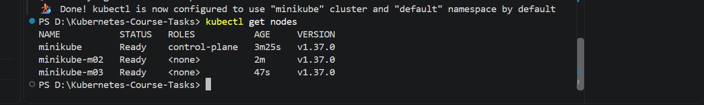

### Pods running, one per node
All 3 Pods are `Running` with `READY 2/2`. The init container doesn't count in READY because it already finished. The Pods are spread over `minikube`, `minikube-m02`, and `minikube-m03`.

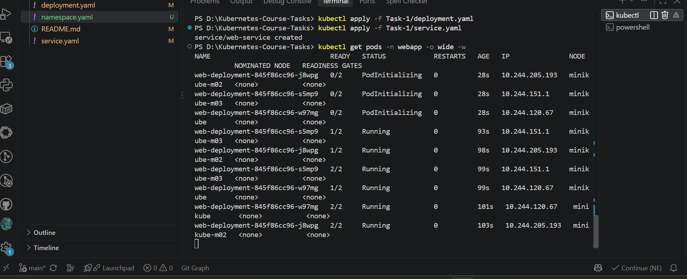

### Init container output and sidecar updates
```bash
kubectl logs deploy/web-deployment -n webapp -c init-done              # -> done
kubectl logs deploy/web-deployment -n webapp -c time-updater --tail=5  # -> one update every 5 seconds
```
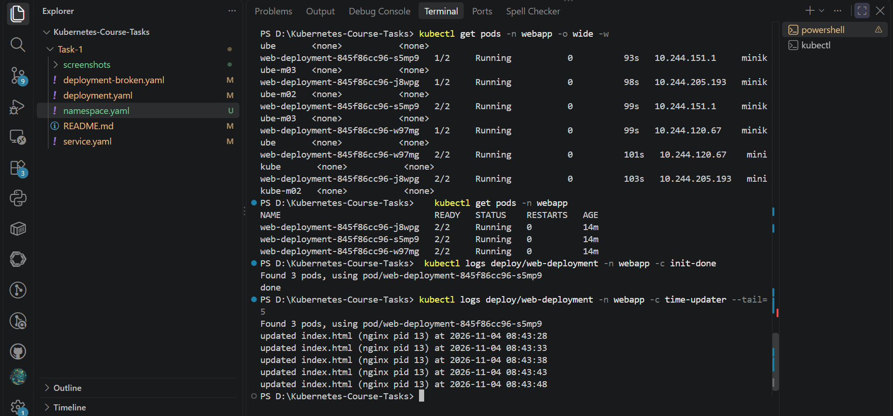

### Timestamp updates in the browser
The same page (via `kubectl port-forward`), refreshed a few seconds apart, shows a new timestamp:

| First load | After refresh |
|---|---|
| 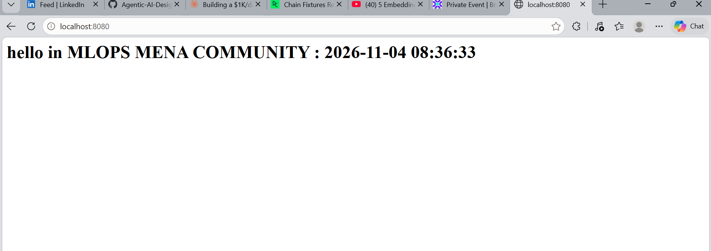 | 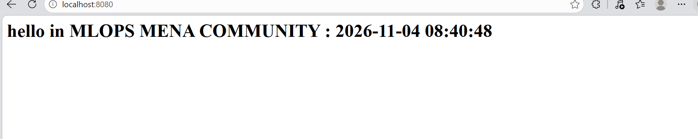 |

> Timestamps are in UTC (container default), which is 3 hours behind Riyadh time (UTC+3).

---

## 💥 Part 2: Forcing the Init Container to Fail

In `deployment-broken.yaml`, the only change is the init container command:

```yaml
# before
command: ["sh", "-c", "echo done"]
# after
command: ["sh", "-c", "echo 'init failed'; exit 1"]
```

Applied over the running Deployment (it was not deleted):

```bash
kubectl apply -f Task-1/deployment-broken.yaml
kubectl get pods -n webapp -o wide -w
```

### Observed: `Init:CrashLoopBackOff`
A new Pod (`web-deployment-<new-hash>-xxxxx`) is created. It cycles through `Init:0/1` → `Init:Error` → `Init:CrashLoopBackOff`, with READY `0/2` and a rising restart count. Kubernetes waits longer between retries each time (exponential back-off).

The **3 original Pods remain `Running 2/2` with 0 restarts.**

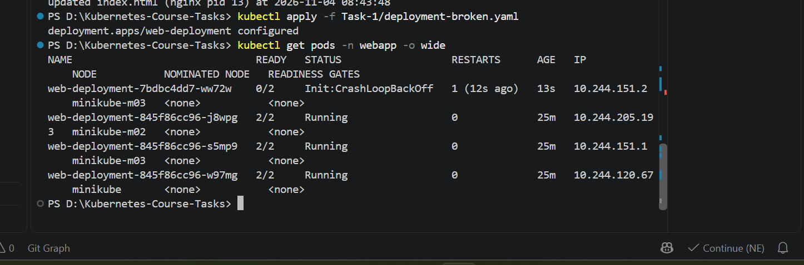

### Answers

- **Which status does the new Pod show?** `Init:Error`, then `Init:CrashLoopBackOff`, READY `0/2`.
- **Do `nginx` and `time-updater` start?** No. Regular containers only start after every init container exits with code `0`. They stay `Waiting` with reason `PodInitializing`.
- **Is the page still reachable, and why?** Yes. This is a rolling update. With `maxSurge: 1` and `maxUnavailable: 0`, Kubernetes adds 1 new Pod and removes an old Pod only after the new one is Ready. The new Pod never becomes Ready, so the rollout stops and the 3 old Pods keep serving. A failed rollout is a safe rollout.

---

## 🔍 Part 3: Failure Diagnosis

```bash
kubectl describe pod <new-pod> -n webapp
kubectl logs <new-pod> -n webapp -c init-done
kubectl get deployment web-deployment -n webapp
kubectl get replicasets -n webapp
kubectl rollout status deploy/web-deployment -n webapp   # waits up to 10 min (Ctrl+C to stop)
```

### `kubectl describe pod`: the init container

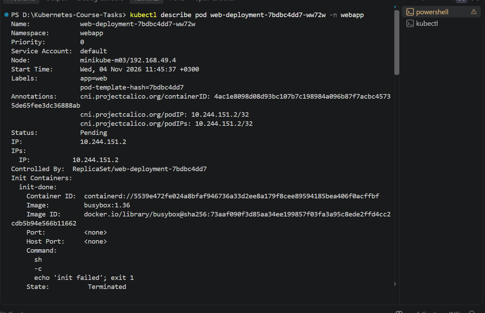

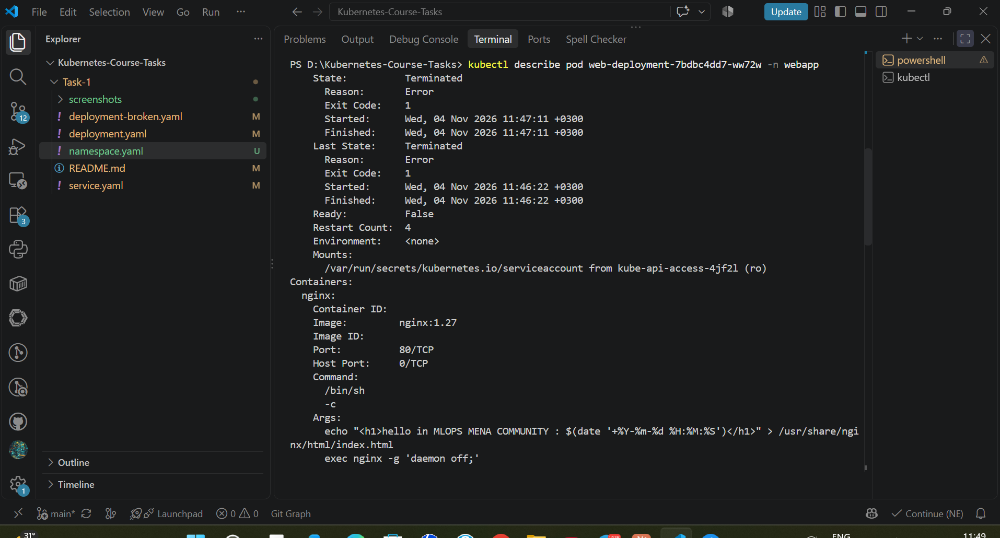

| Evidence | Value | Meaning |
|---|---|---|
| `init-done` → State | `Terminated`, `Reason: Error`, **`Exit Code: 1`** | The init container fails on every run |
| `init-done` → Restart Count | keeps increasing | Kubernetes keeps retrying it |
| `nginx` / `time-updater` → State | `Waiting`, `Reason: PodInitializing` | Never started, because the init gate blocked them |
| Conditions → `Initialized` | `False` | The Pod is stuck in the init phase |
| Events | `Warning BackOff ... Back-off restarting failed container init-done` | Source of the `CrashLoopBackOff` status |
| `kubectl logs -c init-done` | `init failed` | The command ran, then exited with code `1` |

### Deployment and ReplicaSets during the failure

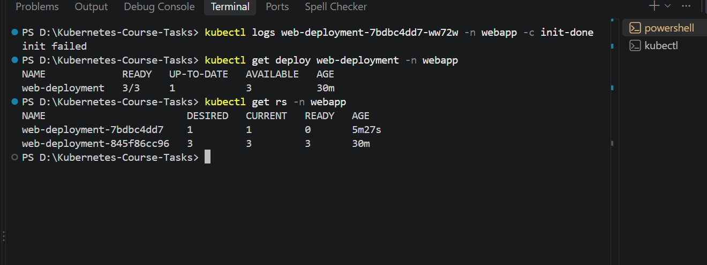

```text
NAME             READY   UP-TO-DATE   AVAILABLE
web-deployment   3/3     1            3

NAME                        DESIRED   CURRENT   READY
web-deployment-<new-hash>   1         1         0     <- new (broken) ReplicaSet
web-deployment-<old-hash>   3         3         3     <- old (working) ReplicaSet
```

- `AVAILABLE 3`: all 3 old Pods still serve traffic.
- `UP-TO-DATE 1`: only 1 Pod has the new spec, and it is not Ready.
- Because of `maxUnavailable: 0`, the rollout **pauses**. No old Pod is removed while the new one is unhealthy.

### Zero downtime: the page keeps working during the failure

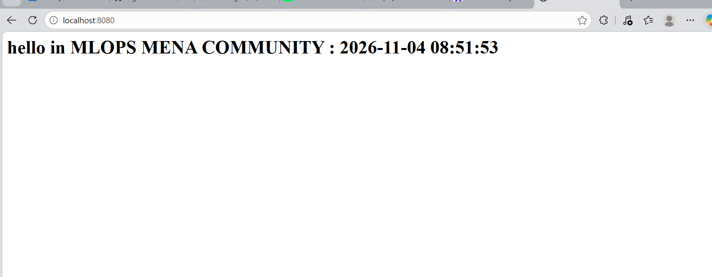

---

## 🔧 Part 4: Fix and Recovery

```bash
kubectl apply -f Task-1/deployment.yaml          # or: kubectl rollout undo deploy/web-deployment -n webapp
kubectl rollout status deploy/web-deployment -n webapp
kubectl get pods -n webapp -o wide
kubectl logs deploy/web-deployment -n webapp -c time-updater --tail=3
```

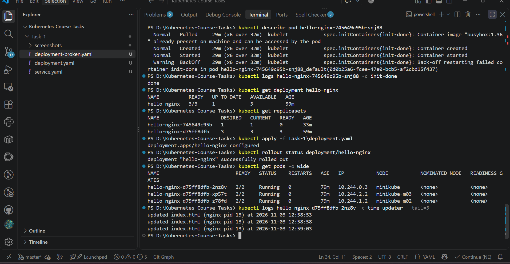

**Why the old Pods were kept:** re-applying the original spec makes it match the old ReplicaSet again. Kubernetes scales the broken ReplicaSet to `0` and keeps the healthy Pods running. Nothing restarts.

---

## 🔍 Verification (task checklist)

| # | Check | Command | Result |
|---|---|---|---|
| 1 | 3 nodes | `kubectl get nodes` | `minikube`, `minikube-m02`, `minikube-m03` `Ready` |
| 2 | Deployment ready | `kubectl get deploy web-deployment -n webapp` | READY `3/3` |
| 3 | Pods running | `kubectl get pods -n webapp -l app=web` | 3 Pods, each `2/2 Running` |
| 4 | Containers | `kubectl get pods -n webapp -l app=web -o jsonpath='{.items[0].spec.initContainers[*].name} {.items[0].spec.containers[*].name}'` | `init-done nginx time-updater` |
| 5 | Init succeeded | `kubectl logs deploy/web-deployment -n webapp -c init-done` | `done` |
| 6 | Sidecar sees nginx | `kubectl exec deploy/web-deployment -n webapp -c time-updater -- ps` | `nginx: master process` listed |
| 7 | Time updates | `kubectl exec deploy/web-deployment -n webapp -c nginx -- cat /usr/share/nginx/html/index.html` (twice, 5 s apart) | New time each read |
| 8 | No volumes | `kubectl get deploy web-deployment -n webapp -o jsonpath='{.spec.template.spec.volumes}'` | Empty |
| 9 | Failing init | `kubectl get pods -n webapp -l app=web` | New Pod `Init:CrashLoopBackOff`, `0/2`; 3 old Pods `2/2 Running` |
| 10 | Init error details | `kubectl describe pod <new-pod> -n webapp` | `init-done`: `Exit Code: 1` |
| 11 | Fixed | `kubectl get deploy web-deployment -n webapp` | READY `3/3`, UP-TO-DATE `3` |

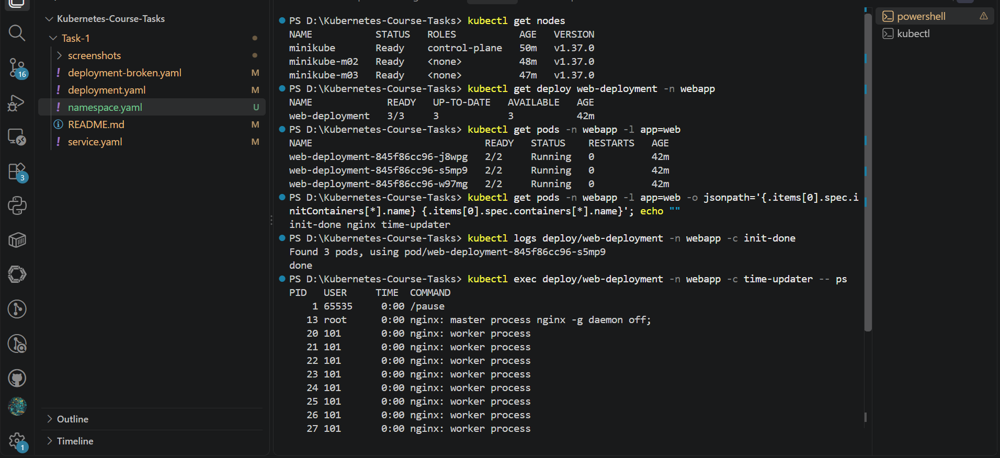

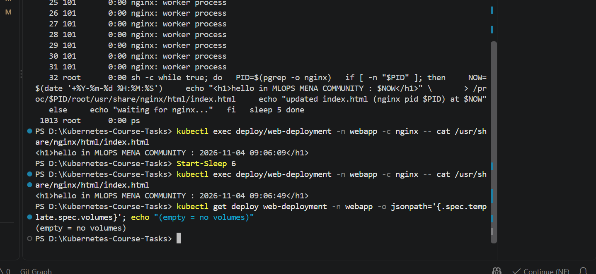

---

## 📚 Key Takeaways

1. **Init containers are a gate.** If one exits non-zero, the main containers never start and the Pod shows `Init:Error` / `Init:CrashLoopBackOff`.
2. **`kubectl describe pod`** is the main diagnosis tool: exit code, restart count, container states, and events.
3. **`maxUnavailable: 0` + a readiness probe** give zero downtime during a bad rollout, because old Pods are kept until new ones are Ready.
4. **`shareProcessNamespace` + `/proc/<pid>/root`** let a sidecar reach another container's filesystem without a shared volume.
5. **Recovery** is just applying the good config again (or `kubectl rollout undo`).

---

## 🧹 Cleanup

Keep the cluster for Task 2. Remove only this task's namespace:

```bash
kubectl delete namespace webapp
```