# Task 2: FastAPI + MySQL with ConfigMap, Secret, PV/PVC & Ingress

A **FastAPI guestbook** app with **one MySQL** server, running in the namespace `webapp-stack` on the 3-node cluster from Task 1:

- 💾 MySQL keeps its data on a **PV + PVC** (`hostPath` pinned to `minikube-m02`).
- ⚙️ App settings are in a **ConfigMap**, and 🔐 the MySQL credentials are in a **Secret**.
- 🚦 Users reach the app through an **Ingress** (NGINX Ingress Controller).

```text
Browser → Ingress Controller → Ingress webapp-ingress → Service webapp-api (80 → 8000) → 2 app Pods
                                                              app Pods → Service mysql (3306) → MySQL Pod → mysql-pvc → mysql-pv
```

---

## 📁 Files

| File | What it creates |
|---|---|
| `webapp/` | Provided FastAPI app + `Dockerfile` (not changed) |
| `mysql/` | Provided MySQL 8.4 image + init script (only change: `COPY --chmod=644` in the Dockerfile, see Troubleshooting) |
| `01-namespace.yaml` | Namespace `webapp-stack` |
| `02-secret.yaml` | Secret `mysql-secret` (`root-password`, `app-user`, `app-password`) |
| `03-configmap.yaml` | ConfigMap `webapp-config` (5 keys) |
| `04-pv-pvc.yaml` | PV `mysql-pv` (2Gi, `manual`, pinned to `minikube-m02`) + PVC `mysql-pvc` |
| `05-mysql.yaml` | Deployment + Service `mysql` (1 replica, `Recreate`, port 3306) |
| `06-webapp.yaml` | Deployment + Service `webapp-api` (2 replicas, port 80 → 8000) |
| `07-ingress.yaml` | Ingress `webapp-ingress` (class `nginx`, `/` → `webapp-api:80`) |
| `screenshots/` | Evidence for every step |

### Where each variable comes from

| Container | Variable | Source |
|---|---|---|
| app | `APP_TITLE`, `APP_ENV`, `MYSQL_HOST`, `MYSQL_PORT`, `MYSQL_DATABASE` | ConfigMap `webapp-config` (`envFrom`) |
| app | `MYSQL_USER`, `MYSQL_PASSWORD` | Secret `mysql-secret` (`app-user`, `app-password`) |
| mysql | `MYSQL_ROOT_PASSWORD`, `APP_DB_USER`, `APP_DB_PASSWORD` | Secret `mysql-secret` (`secretKeyRef`) |
| mysql | `APP_DB_NAME` | ConfigMap `webapp-config`, key `MYSQL_DATABASE` (`configMapKeyRef`) |

---

## 🚀 Steps

### 1. Build the images and load them into minikube
```bash
docker build -t webapp-api:task2 ./webapp
docker build -t webapp-mysql:task2 ./mysql
minikube image load webapp-api:task2
minikube image load webapp-mysql:task2
minikube image ls
```
Both Deployments use `imagePullPolicy: IfNotPresent`, so Kubernetes uses the loaded local images instead of pulling from a registry.

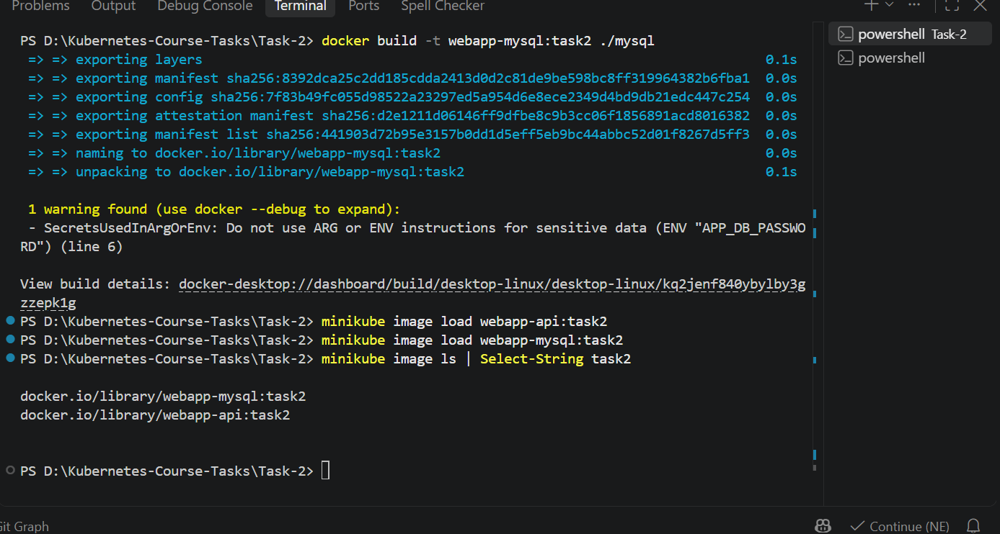

### 2–4. Namespace, Secret, ConfigMap
```bash
kubectl apply -f 01-namespace.yaml
kubectl apply -f 02-secret.yaml
kubectl apply -f 03-configmap.yaml
kubectl get secret mysql-secret -n webapp-stack
kubectl get configmap webapp-config -n webapp-stack
```
- The Secret uses `stringData`, so the values are written in plain text and Kubernetes stores them base64-encoded.
- `MYSQL_PORT` stays in the ConfigMap on purpose. Kubernetes adds `MYSQL_PORT=tcp://<ip>:3306` for the Service `mysql`, and the ConfigMap value overrides it with a plain `3306`.

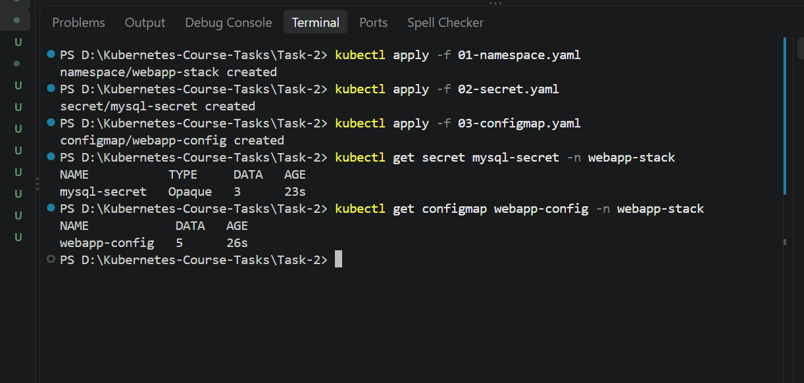

### 5. PV and PVC
```bash
kubectl apply -f 04-pv-pvc.yaml
kubectl get pv mysql-pv
kubectl get pvc mysql-pvc -n webapp-stack
```
- The PV has **no namespace**. The PVC is in `webapp-stack`.
- Both use `storageClassName: manual`, so the PVC binds to our PV instead of minikube's default `standard` class.
- `persistentVolumeReclaimPolicy: Retain` keeps the data if the PVC is deleted.
- **Why `nodeAffinity`:** a `hostPath` folder exists on one node only. Pinning the PV to `minikube-m02` makes every Pod that uses it run on `minikube-m02`, where the data is. Without it, a restarted MySQL Pod could land on another node and get an empty folder.

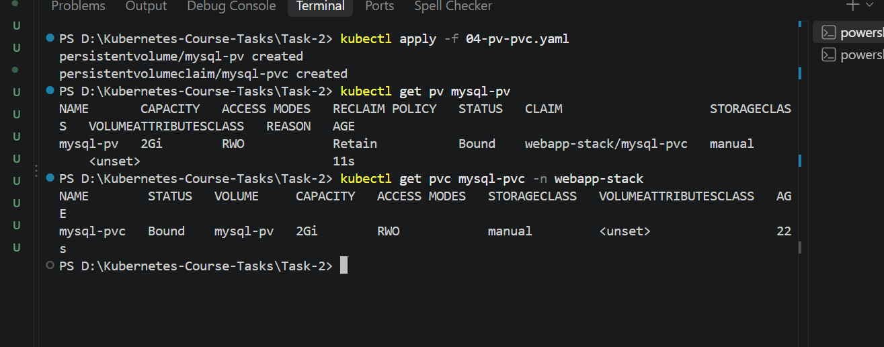

### 6. MySQL Deployment and Service
```bash
kubectl apply -f 05-mysql.yaml
kubectl logs deploy/mysql -n webapp-stack        # "ready for connections"
kubectl get endpoints mysql -n webapp-stack      # 1 IP on port 3306
```
- `strategy: Recreate` stops the old Pod before the new one starts, so two MySQL servers never use the same data folder.
- Probes all use `mysqladmin ping -h 127.0.0.1`: a `startupProbe` (up to 5 min for the first start), a readiness probe, and a liveness probe with `initialDelaySeconds: 60`.
- The database, the app user and the `messages` table are created only on the first start, when the data folder is empty.

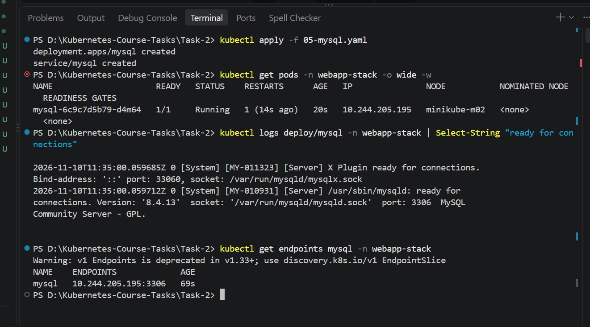

### 7. App Deployment and Service
```bash
kubectl apply -f 06-webapp.yaml
kubectl exec -n webapp-stack deploy/webapp-api -- env | grep -E "APP_|MYSQL_"
kubectl get endpoints webapp-api -n webapp-stack   # 2 IPs on port 8000
```
- `envFrom` loads all 5 ConfigMap keys at once, because the key names match the app's variable names.
- `MYSQL_HOST: mysql` works because a Service name is a DNS name inside the namespace.
- Readiness and liveness probes: `GET /health` on port 8000.

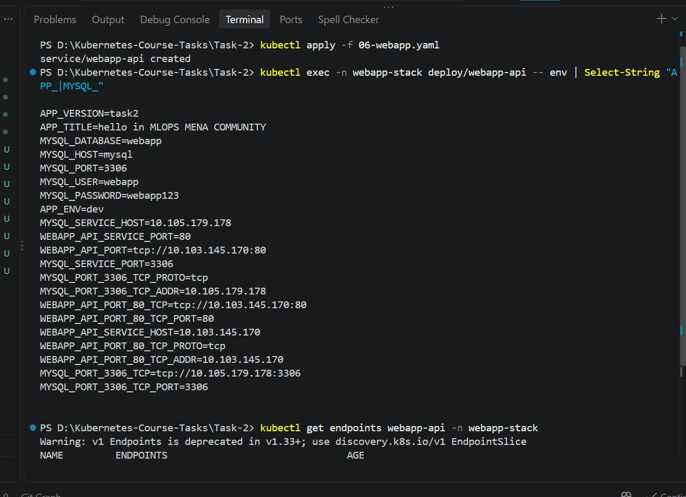

### 8. Ingress Controller
```bash
minikube addons enable ingress
kubectl get pods -n ingress-nginx
kubectl get ingressclass
```
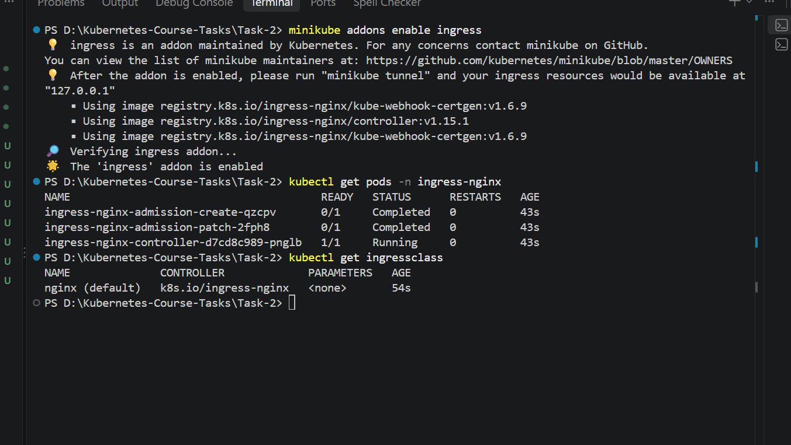

### 9. Ingress
```bash
kubectl apply -f 07-ingress.yaml
kubectl get ingress webapp-ingress -n webapp-stack
```
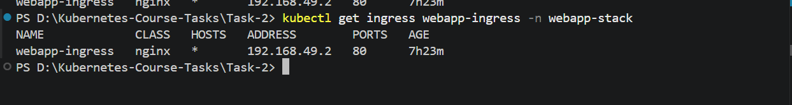

### 10. Open the app
```bash
kubectl get pods -n webapp-stack -o wide
kubectl port-forward -n ingress-nginx svc/ingress-nginx-controller 8080:80
```
Then open http://localhost:8080.

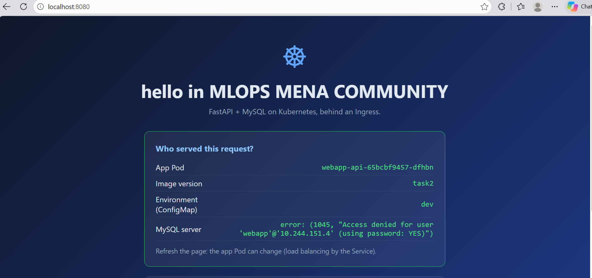

---

## 🔍 Verification

| # | Check | Command | Result |
|---|---|---|---|
| 1 | Images loaded | `minikube image ls` | `webapp-api:task2`, `webapp-mysql:task2` |
| 2 | Secret and ConfigMap | `kubectl get secret mysql-secret -n webapp-stack` / `kubectl get configmap webapp-config -n webapp-stack` | DATA `3` and `5` |
| 3 | PV and PVC bound | `kubectl get pv mysql-pv` / `kubectl get pvc mysql-pvc -n webapp-stack` | `Bound`, `2Gi` |
| 4 | Deployments ready | `kubectl get deploy -n webapp-stack` | `mysql 1/1`, `webapp-api 2/2` |
| 5 | MySQL on the PV node | `kubectl get pods -n webapp-stack -l app=mysql -o wide` | `1/1 Running` on `minikube-m02` |
| 6 | App env | `kubectl exec -n webapp-stack deploy/webapp-api -- env` | `APP_TITLE`, `MYSQL_HOST=mysql`, `MYSQL_USER`, `MYSQL_PASSWORD` |
| 7 | Default data | `"SELECT * FROM webapp.messages;" \| kubectl exec -i -n webapp-stack deploy/mysql -- sh -c 'mysql -uroot -p$MYSQL_ROOT_PASSWORD'` | 2 default messages |
| 8 | Ingress | `kubectl get ingress webapp-ingress -n webapp-stack` | CLASS `nginx`, ADDRESS filled |
| 9 | App info | `curl.exe http://localhost:8080/api/info` | `"version": "task2"`, title, `"environment": "dev"`, `db` with the MySQL server |
| 10 | Write a message | `curl.exe -X POST http://localhost:8080/api/messages -H "Content-Type: application/json" -d "@msg.json"` | `{"id": 3, "written_to": "mysql-..."}` |
| 11 | Read messages | `curl.exe http://localhost:8080/api/messages` | My message + the 2 default ones |
| 12 | Data survives a restart | `kubectl delete pod -n webapp-stack -l app=mysql`, then check 11 again | My message is still there |

> On Windows PowerShell, check 7 pipes the SQL into `kubectl exec` because PowerShell strips the inner `"` quotes. For check 10, the JSON body is saved first with `'{"author":"student","content":"hello"}' | Out-File -Encoding ascii msg.json`.

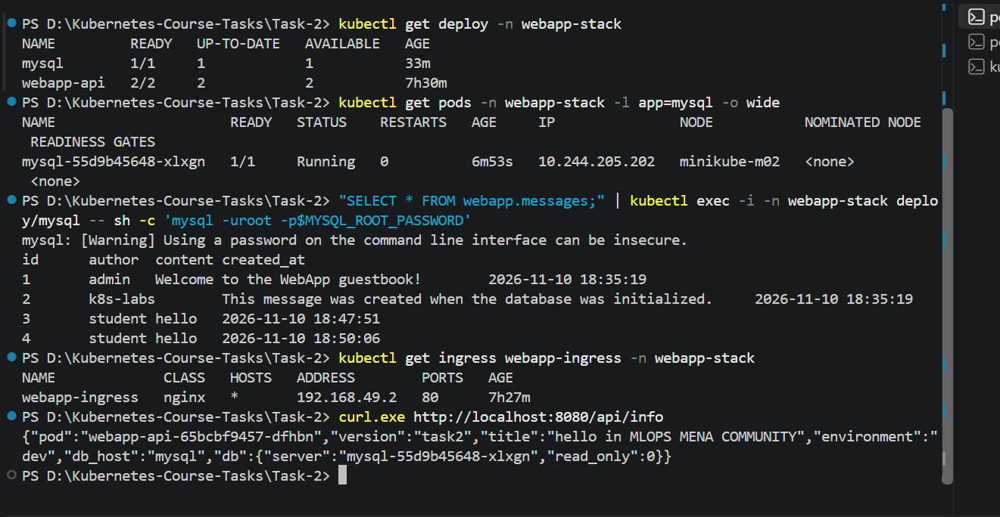

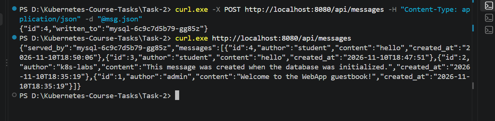

### Persistence test (check 12)

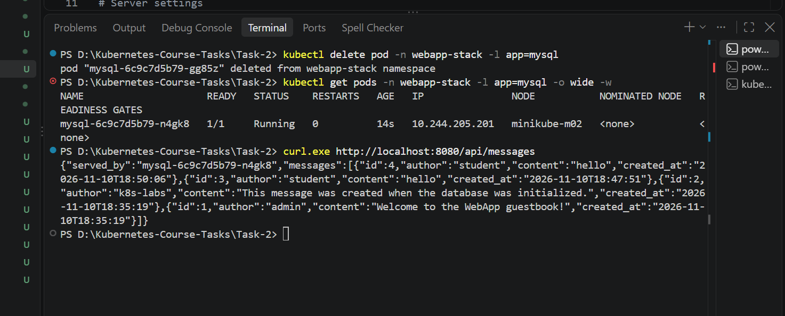

The MySQL Pod was deleted, and the Deployment created a new one. Because of `nodeAffinity`, it started on `minikube-m02` again, mounted the same `hostPath` folder through `mysql-pvc`, and the message written before the restart was still there.

---

## 🛠️ Troubleshooting (what went wrong and how I fixed it)

### Problem: the app got `Access denied for user 'webapp'`

**What I saw:** `/api/messages` returned `Access denied for user 'webapp'@'10.244.x.x'`. In MySQL, `root` existed but there was **no `webapp` user and no `webapp` database**. The MySQL Pod also had `RESTARTS 1` right after creation.

**How I found the cause:** the logs of the first (crashed) container showed:

```text
running /docker-entrypoint-initdb.d/01-setup.sh
01-setup.sh: line 9: mysql_note: command not found
01-setup.sh: line 10: docker_process_sql: command not found
```

**Cause:** the MySQL entrypoint **sources** an init script that is not executable (so its helper functions `mysql_note` and `docker_process_sql` are available), but **runs** a script that is executable, in a separate process where those functions don't exist. Docker Desktop on Windows marks every copied file as executable, so the script was *run* instead of *sourced* and failed. The container restarted with a data folder that was no longer empty, so MySQL skipped the setup and never created the database or the app user.

**Fix:** one line in `mysql/Dockerfile`, so the file is readable but not executable:

```dockerfile
COPY --chmod=644 initdb/01-setup.sh /docker-entrypoint-initdb.d/01-setup.sh
```

Then rebuilt the image, emptied the data folder, and redeployed:

```bash
kubectl delete -f 05-mysql.yaml
docker build --no-cache -t webapp-mysql:task2 ./mysql
minikube image load --overwrite=true webapp-mysql:task2
minikube ssh -n minikube-m02 -- sudo rm -rf /data/webapp-mysql
kubectl apply -f 05-mysql.yaml
```

### Extra safety changes

- **Line endings:** converted the MySQL scripts to LF and added `.gitattributes` (`*.sh text eol=lf`), so Git on Windows doesn't turn them into CRLF, which also breaks bash scripts.
- **`startupProbe` on MySQL:** gives the first start (which creates the database) up to 5 minutes before the liveness probe can restart the container, so a slow first start is never interrupted halfway.

### Lesson

MySQL creates its database and users **only once**, on an empty data folder. If the first start fails, the folder must be emptied before trying again; otherwise MySQL keeps skipping the setup.

---

## 📚 Key Takeaways

1. **ConfigMap vs Secret:** non-sensitive settings go in a ConfigMap, credentials in a Secret. `envFrom` loads a whole ConfigMap; `secretKeyRef` / `configMapKeyRef` load one key.
2. **PV/PVC binding** needs the same `storageClassName`. `volumeName` binds the PVC to one specific PV.
3. **`hostPath` + `nodeAffinity`:** local data lives on one node, so the PV must pin its Pods to that node.
4. **`Recreate`** is the safe strategy for a single database Pod.
5. **Service names are DNS names** (`mysql`), so the app finds the database without IP addresses.
6. **Ingress** needs an Ingress Controller. The Ingress object is only routing rules.

---

## 🧹 Clean Up

Keep everything for Task 3. It starts from this stack and these YAML files.